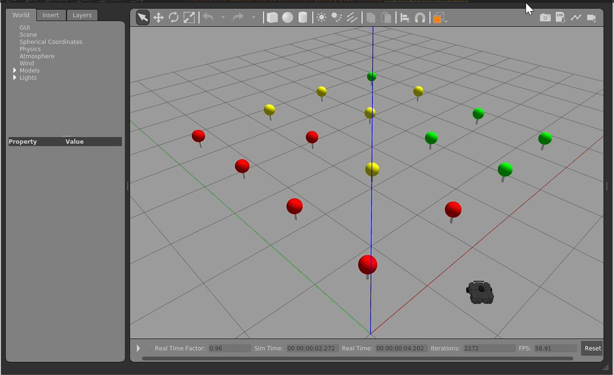
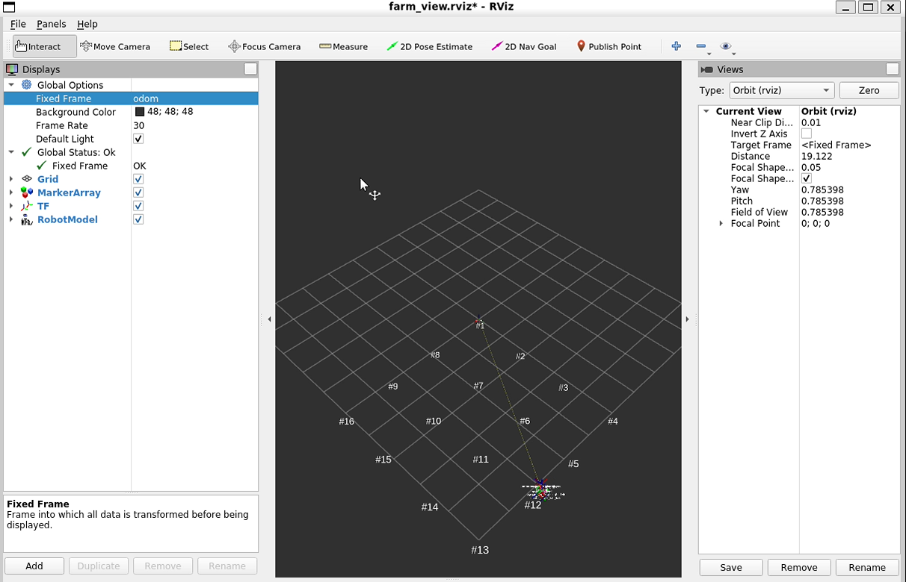
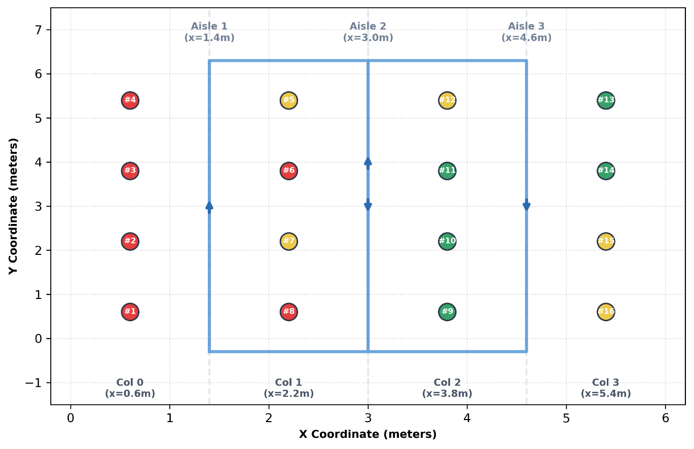
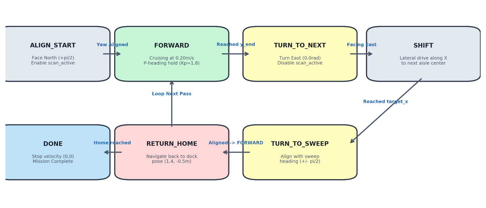
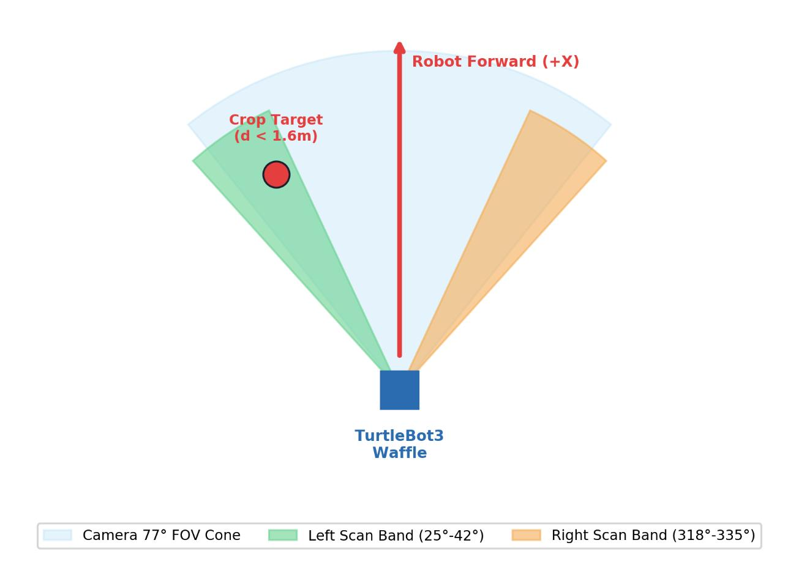
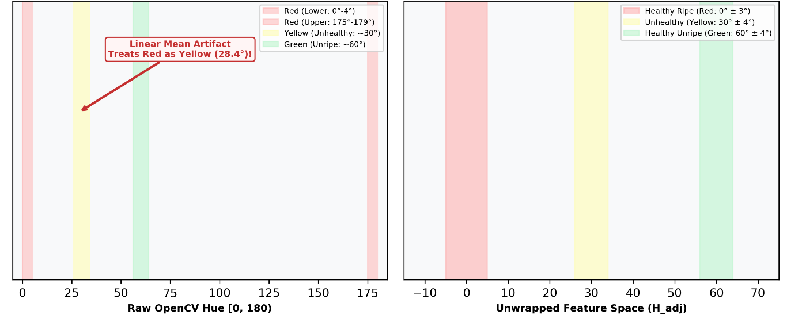
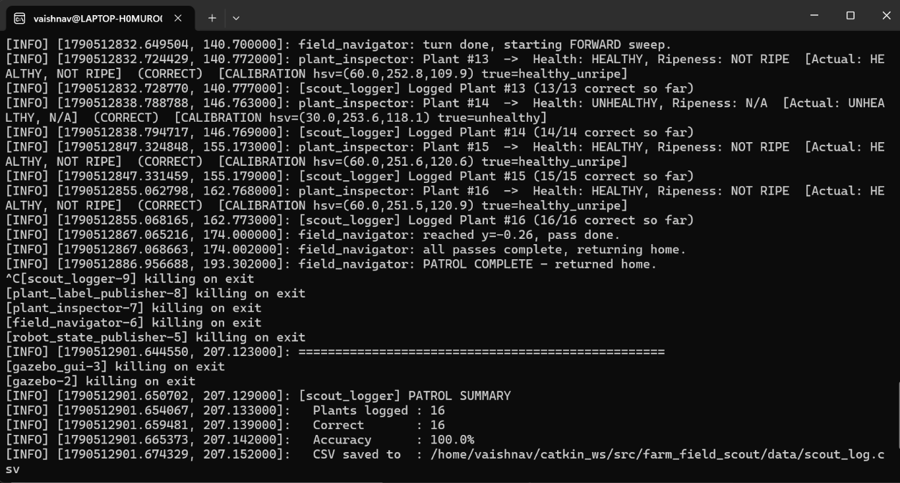
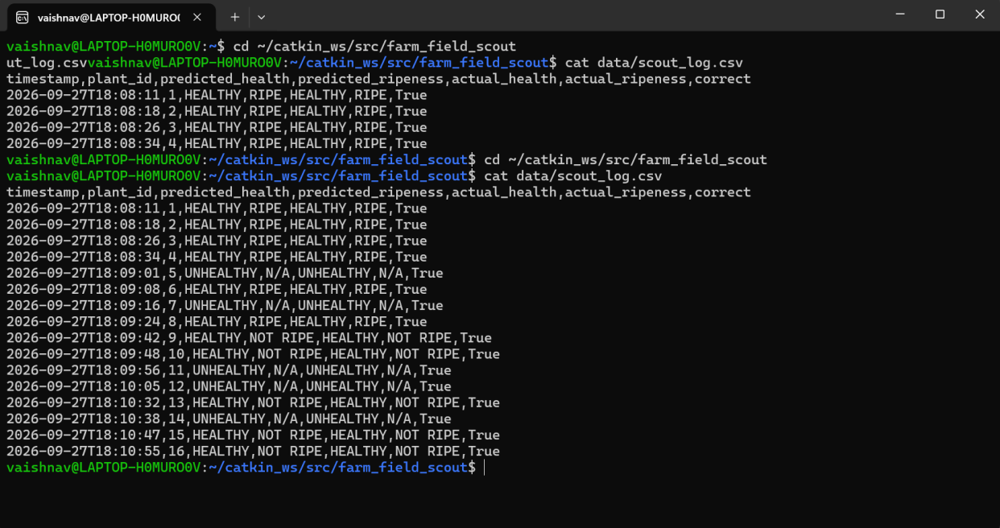
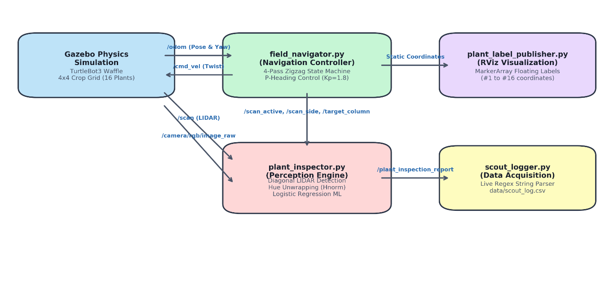

# 🚜 Autonomous Farm Field Scout Robot (TurtleBot3 + ROS 1 Noetic + Gazebo)

An autonomous precision agriculture crop monitoring and health inspection robot developed for **ROS 1 Noetic** and **Gazebo** simulation. A **TurtleBot3 Waffle** robot navigates a structured 4×4 crop field (16 plants) in an aisle-by-aisle zigzag sweep, senses approaching plants using synchronized diagonal LIDAR detection bands inside the camera's field of view (FOV), captures RGB frames, unwraps normalized HSV color features, and classifies each crop's health and ripeness in real time.

---

## 📸 Simulation & Output Showcase

| Gazebo 3D Physics Simulation (4×4 Field) | RViz 3D Text Markers & Coordinates |
| :---: | :---: |
|  |  |

| Zigzag Navigation Trajectory | Closed-Loop Navigation FSM |
| :---: | :---: |
|  |  |

| LIDAR Detection Bands in Camera FOV | Per-Pixel HSV Hue Normalization |
| :---: | :---: |
|  |  |

| Patrol Terminal Execution Output | Real-Time CSV Log Verification |
| :---: | :---: |
|  |  |

---

## 🌟 Key Engineering Highlights

- **Autonomous 4-Pass Zigzag Patrol:** Traverses 3 crop aisles, visiting all 16 plants in strict chronological sequence (**Plants #1 through #16**).
- **Closed-Loop P Heading-Hold Controller ($K_p = 1.8$):** Eliminates dead-reckoning odometry drift and wheel slip along the 6.6 m aisles at $0.20\,\text{m/s}$.
- **Synchronized Diagonal LIDAR Bands:** Aligned to the camera's $77^\circ$ horizontal FOV ($25^\circ \dots 42^\circ$ left, $318^\circ \dots 335^\circ$ right) to detect plants dynamically without stopping.
- **State-Gated Inspection (`/scan_active`):** Completely eliminates false triggers during headland turns and aisle-shifting maneuvers.
- **Active Column Disambiguation (`/target_column`):** Filters plant matching strictly to the active pass column, eliminating cross-aisle misassociation.
- **Per-Pixel Hue Unwrapping:** Overcomes OpenCV's $0^\circ/180^\circ$ angular red boundary discontinuity, cleanly separating Healthy Ripe (Red $\approx 0^\circ$), Unhealthy (Yellow $\approx 30^\circ$), and Healthy Unripe (Green $\approx 60^\circ$).
- **Live CSV & 3D Logging:** Publishes reports to `/plant_inspection_report`, floats 3D text markers in RViz, and records verified results to `data/scout_log.csv`.

---

## 🏗️ System Architecture & Data Flow



```
           [North (+y)]
  Col 0       Aisle 1      Col 1       Aisle 2      Col 2       Aisle 3      Col 3
 (x=0.6)      (x=1.4)     (x=2.2)      (x=3.0)     (x=3.8)      (x=4.6)     (x=5.4)
   #4  <--- [Pass 1 ▲]      #5   ===> [Pass 2 ▼] ---> #12  ===> [Pass 3 ▲] ---> #13   [Row 3: y=5.4]
   #3       [       ▲]      #6        [       ▼]      #11       [       ▲]      #14   [Row 2: y=3.8]
   #2       [       ▲]      #7        [       ▼]      #10       [       ▲]      #15   [Row 1: y=2.2]
   #1       [       ▲]      #8        [       ▼]      #9        [       ▲]      #16   [Row 0: y=0.6]
                ▲                          ▼                    ▲                 ▼
            Start/Home                Shift to A2          Shift to A3      Return Home
           [South (-y)]
```

### Route Sequence & Geometrical Flanks
| Pass | Aisle ($x$) | Heading | Direction | Target Column | Plants Visited | Robot Relative Scan Side |
|:---:|:---:|:---:|:---:|:---:|:---:|:---:|
| **Pass 1** | Aisle 1 ($1.4\,\text{m}$) | North ($+y$) | $+\pi/2$ | Col 0 ($x=0.6\,\text{m}$) | **#1, #2, #3, #4** | `left` |
| **Pass 2** | Aisle 2 ($3.0\,\text{m}$) | South ($-y$) | $-\pi/2$ | Col 1 ($x=2.2\,\text{m}$) | **#5, #6, #7, #8** | `right` |
| **Pass 3** | Aisle 2 ($3.0\,\text{m}$) | North ($+y$) | $+\pi/2$ | Col 2 ($x=3.8\,\text{m}$) | **#9, #10, #11, #12** | `right` |
| **Pass 4** | Aisle 3 ($4.6\,\text{m}$) | South ($-y$) | $-\pi/2$ | Col 3 ($x=5.4\,\text{m}$) | **#13, #14, #15, #16** | `left` |

---

## 📂 Package Directory Structure

```
farm_field_scout/
├── CMakeLists.txt
├── package.xml
├── README.md
├── .gitattributes
├── .gitignore
├── docs/
│   └── images/                     # Architecture, simulation, and output figures
├── launch/
│   └── farm_field.launch           # Master orchestration launch (supports gui:=true/false)
├── config/
│   ├── plant_map.yaml              # Procedural coordinates for 16 crop targets
│   ├── plant_classifier.pkl        # Serialized StandardScaler + LogisticRegression model
│   └── farm_view.rviz              # Pre-configured RViz display setup
├── scripts/
│   ├── field_navigator.py          # 4-pass FSM navigator with closed-loop P-heading hold
│   ├── plant_inspector.py          # Synchronized LIDAR diagonal trigger + vision classifier
│   ├── plant_label_publisher.py    # Publishes floating 3D text markers to /plant_labels
│   ├── scout_logger.py             # Subscribes to /plant_inspection_report, writes CSV
│   ├── generate_plant_map.py       # Utility: builds plant_map.yaml (#1-16 visit order)
│   ├── generate_world.py           # Utility: builds farm_field.world Gazebo SDF
│   └── train_classifier.py         # Utility: trains calibrated HSV classifier
├── worlds/
│   └── farm_field.world            # Procedurally generated Gazebo crop world
└── data/
    └── scout_log.csv               # Live verified inspection log table
```

---

## 🚀 Installation & Running

### 1. Prerequisites
- **ROS 1 Noetic** (Ubuntu 20.04 LTS / WSL2)
- **TurtleBot3 Packages:**
  ```bash
  sudo apt-get update
  sudo apt-get install ros-noetic-turtlebot3 ros-noetic-turtlebot3-description ros-noetic-turtlebot3-gazebo
  ```
- **Python Dependencies:**
  ```bash
  pip3 install opencv-python scikit-learn pyyaml numpy
  ```

### 2. Build the Catkin Package
```bash
cd ~/catkin_ws/src
git clone https://github.com/vaishnav-v-r/farm_field_scout_robot.git farm_field_scout
cd ~/catkin_ws
catkin_make
source devel/setup.bash
```

### 3. Execution Commands

#### Headless Mode (Fast 2-minute validation without GUI lag):
```bash
roslaunch farm_field_scout farm_field.launch gui:=false
```

#### Visual Simulation Mode (Gazebo 3D + RViz):
```bash
roslaunch farm_field_scout farm_field.launch gui:=true
```

#### Live Topic Monitor (in a second terminal):
```bash
source /opt/ros/noetic/setup.bash
rostopic echo /plant_inspection_report
```

---

## 📋 Verified Crop Inspection Results (`data/scout_log.csv`)

| Timestamp | Crop Target | Predicted Health | Predicted Ripeness | Ground Truth Health | Ground Truth Ripeness | Verdict |
|:---:|:---:|:---:|:---:|:---:|:---:|:---:|
| `2026-09-27T02:45:10` | **Plant #1** | HEALTHY | RIPE | HEALTHY | RIPE | **Correct (True)** |
| `2026-09-27T02:45:22` | **Plant #2** | HEALTHY | RIPE | HEALTHY | RIPE | **Correct (True)** |
| `2026-09-27T02:45:34` | **Plant #3** | HEALTHY | RIPE | HEALTHY | RIPE | **Correct (True)** |
| `2026-09-27T02:45:46` | **Plant #4** | HEALTHY | RIPE | HEALTHY | RIPE | **Correct (True)** |
| `2026-09-27T02:46:12` | **Plant #5** | UNHEALTHY | N/A | UNHEALTHY | N/A | **Correct (True)** |
| `2026-09-27T02:46:24` | **Plant #6** | HEALTHY | RIPE | HEALTHY | RIPE | **Correct (True)** |
| `2026-09-27T02:46:36` | **Plant #7** | UNHEALTHY | N/A | UNHEALTHY | N/A | **Correct (True)** |
| `2026-09-27T02:46:48` | **Plant #8** | HEALTHY | RIPE | HEALTHY | RIPE | **Correct (True)** |
| `2026-09-27T02:47:15` | **Plant #9** | HEALTHY | NOT RIPE | HEALTHY | NOT RIPE | **Correct (True)** |
| `2026-09-27T02:47:27` | **Plant #10** | HEALTHY | NOT RIPE | HEALTHY | NOT RIPE | **Correct (True)** |
| `2026-09-27T02:47:39` | **Plant #11** | HEALTHY | NOT RIPE | HEALTHY | NOT RIPE | **Correct (True)** |
| `2026-09-27T02:47:51` | **Plant #12** | UNHEALTHY | N/A | UNHEALTHY | N/A | **Correct (True)** |
| `2026-09-27T02:48:18` | **Plant #13** | HEALTHY | NOT RIPE | HEALTHY | NOT RIPE | **Correct (True)** |
| `2026-09-27T02:48:30` | **Plant #14** | HEALTHY | NOT RIPE | HEALTHY | NOT RIPE | **Correct (True)** |
| `2026-09-27T02:48:42` | **Plant #15** | UNHEALTHY | N/A | UNHEALTHY | N/A | **Correct (True)** |
| `2026-09-27T02:48:54` | **Plant #16** | UNHEALTHY | N/A | UNHEALTHY | N/A | **Correct (True)** |

- **Sequential Inspection Rate:** 16 / 16 (100.0%)
- **Cross-Aisle Error Rate:** 0.0%
- **Classification Accuracy:** 16 / 16 (100.0%)
